<div align="center">

# 🧡 Collaborative Kanban Board

**A warm, realtime Kanban board where your team moves cards, chats on tasks, and sees who's around, all live.**

[](https://react.dev)
[](https://www.typescriptlang.org)
[](https://vite.dev)
[](https://tailwindcss.com)
[](https://supabase.com)
[](https://collaborative-kanban-board-gold.vercel.app)

### [🌐 Open the live site](https://collaborative-kanban-board-gold.vercel.app)

</div>

> [!TIP]
> **✦ Try the demo, no sign-up needed.** Open the [live site](https://collaborative-kanban-board-gold.vercel.app) and click **Try the demo** on the sign-in screen. You'll land on a shared sample board you can freely poke at. It resets every hour, so nothing you do there sticks around.

<p align="center">
  <picture>
    <source media="(prefers-color-scheme: dark)" srcset="docs/screenshots/02-demo-board-card-chips-dark.png">
    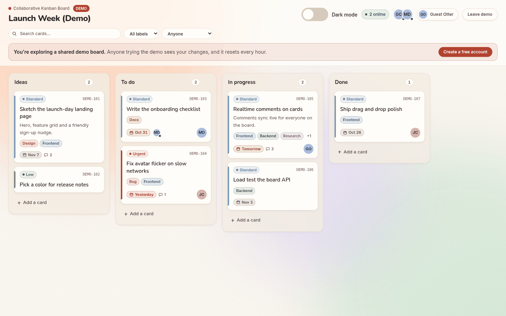
  </picture>
</p>

## ✨ Features

**Collaboration**
- **Realtime sync:** card, list, comment and label changes show up for everyone on the board without a refresh (Supabase Realtime).
- **Presence:** see who's online in the header, and who's looking at a card, via Supabase Presence.
- **Drag and drop:** move cards within and between columns with `@dnd-kit`. Updates are optimistic, and a failed write shows an error toast and resyncs from the server.
- **Live comments:** every card has a comment thread that updates live. You can edit or delete your own comments.

**Organizing work**
- **Labels:** colored, board-wide labels you create and assign in the card modal, shown as chips on cards.
- **Due dates:** chips turn amber when a card is due within two days and red once it's overdue.
- **Assignees and profiles:** pick anyone on the board (or "Assign to me"). Set a display name and upload an avatar, with initials as a fallback.
- **Search and filters:** narrow the board by text, label or assignee from the header.
- **Cards and columns:** create, edit and delete cards (title, description, priority, assignee, labels, due date), add and delete columns with a confirmation step, and rename the board inline.

**Look and feel**
- **Warm cream and terracotta theme** with a persisted **dark mode** that follows your system setting by default.
- **React Bits accents:** a soft Aurora background, a Blur Text title reveal, a Spotlight glow that follows the cursor on cards, and warm click sparks on every click or tap.
- **Little moments:** a small confetti check when a card lands in a "Done"-style column.
- **Reduced motion:** the Aurora falls back to a static gradient, and sparks and confetti switch off under `prefers-reduced-motion`.
- **Accessible dialogs:** modals use `role="dialog"`/`alertdialog` with `aria-modal`, trap focus, close on Escape, and return focus to the trigger.

**Demo mode**
- One click signs a visitor in anonymously to a seeded demo board with a **Demo** badge. Row-level security keeps demo users away from real boards and real people's profiles.

## 📸 Screenshots

<table>
  <tr>
    <th width="50%">Light</th>
    <th width="50%">Dark</th>
  </tr>
  <tr>
    <td colspan="2" align="center"><b>Sign in, or try the demo</b></td>
  </tr>
  <tr>
    <td>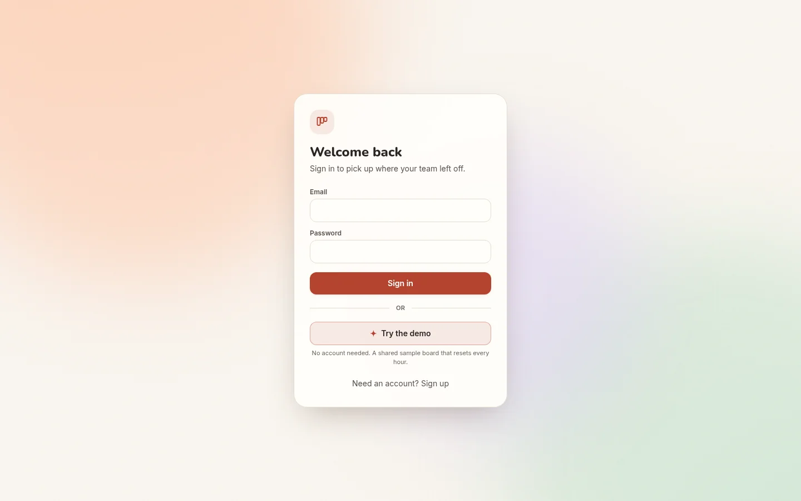</td>
    <td>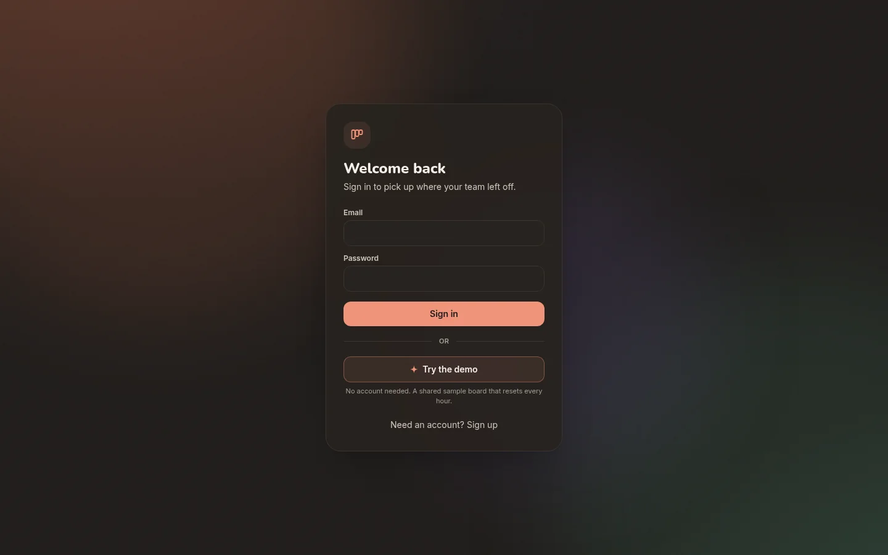</td>
  </tr>
  <tr>
    <td colspan="2" align="center"><b>Card details: labels, due date, assignee and live comments</b></td>
  </tr>
  <tr>
    <td>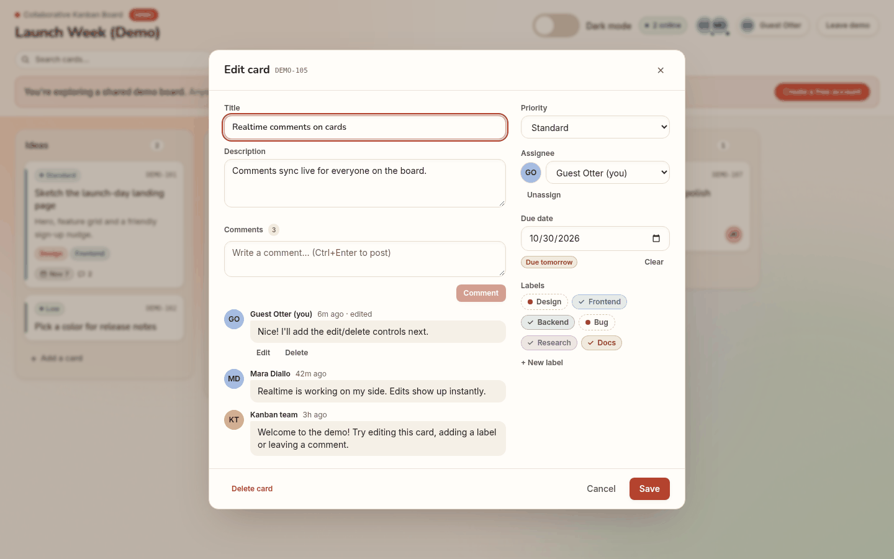</td>
    <td>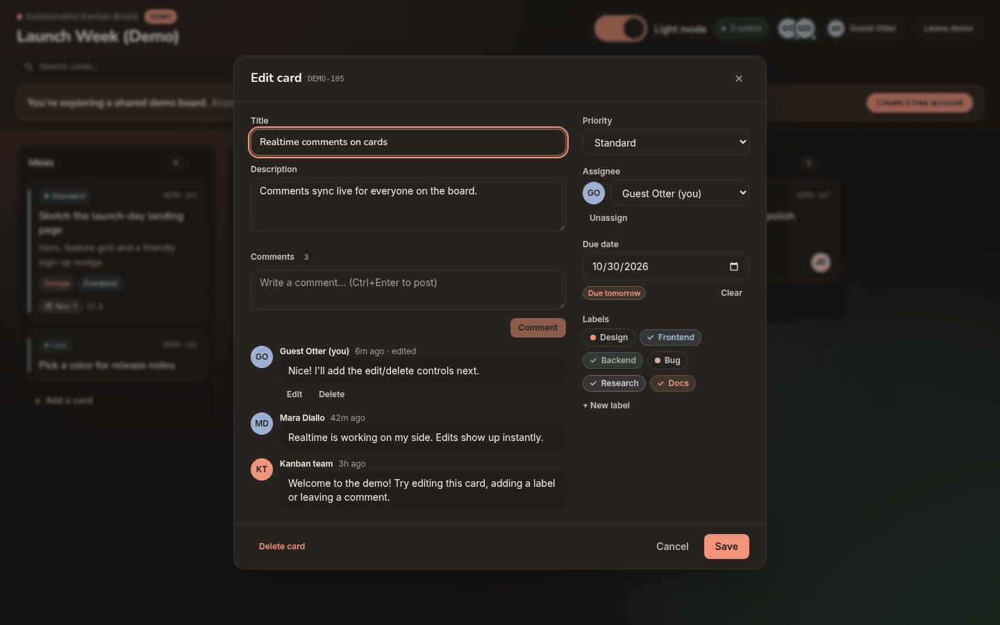</td>
  </tr>
  <tr>
    <td colspan="2" align="center"><b>Profile: display name and avatar</b></td>
  </tr>
  <tr>
    <td>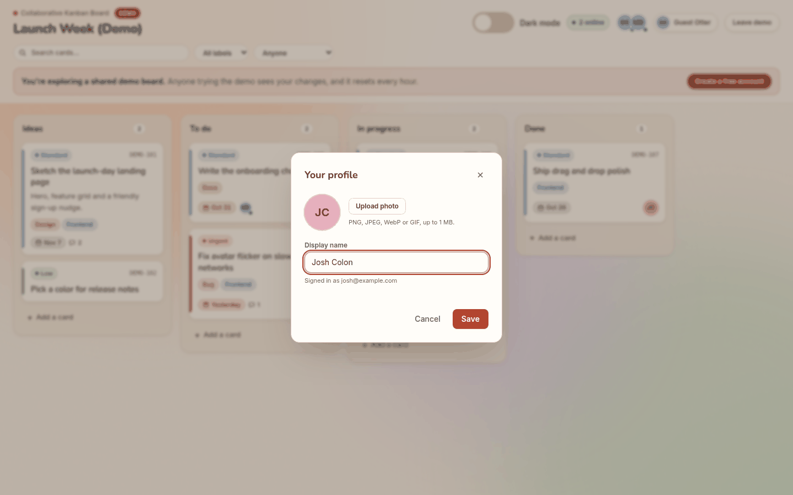</td>
    <td>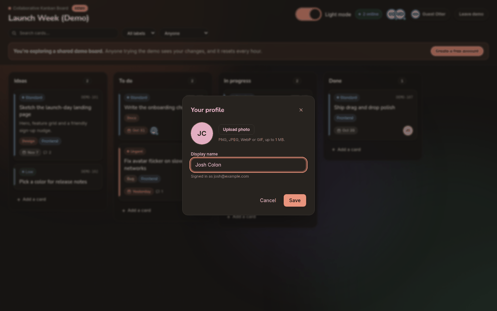</td>
  </tr>
  <tr>
    <td colspan="2" align="center"><b>Board, plus a close-up of card chips</b></td>
  </tr>
  <tr>
    <td></td>
    <td>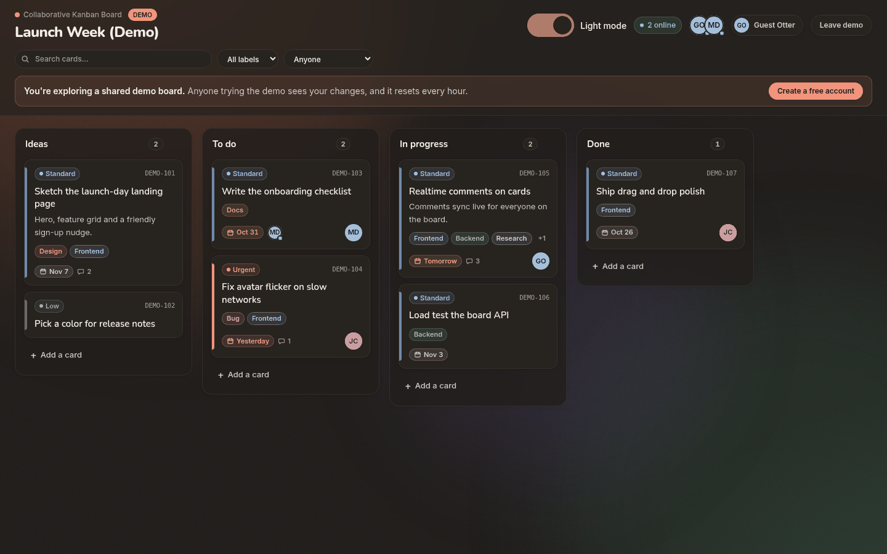</td>
  </tr>
  <tr>
    <td align="center">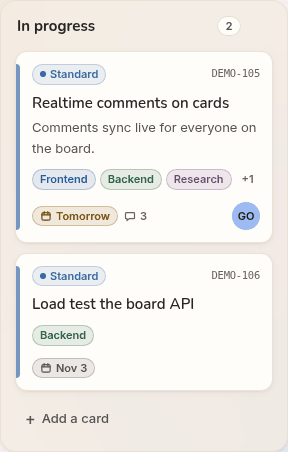</td>
    <td align="center">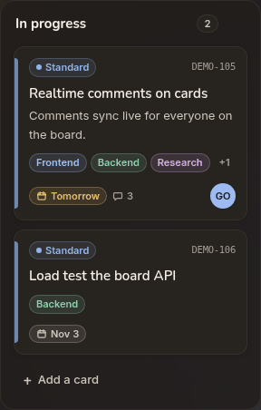</td>
  </tr>
</table>

## 🧰 Tech stack

| Area        | What's used                                                         |
| ----------- | ------------------------------------------------------------------- |
| UI          | React 19, TypeScript, Tailwind CSS, Motion                          |
| Interaction | `@dnd-kit/core` and `@dnd-kit/sortable`                             |
| Backend     | Supabase Auth (email/password + anonymous), Postgres, Realtime, Presence, Storage, `pg_cron` |
| Tooling     | Vite, Oxlint, PostCSS                                               |
| Hosting     | Vercel, deployed from `main`                                        |

## 🏗️ How it works

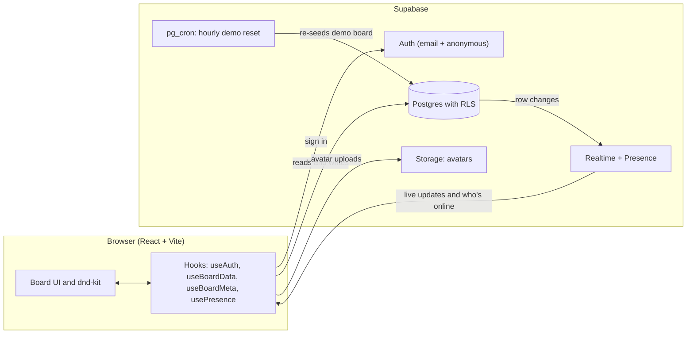

- **Optimistic UI:** the client updates state first, then writes to Postgres. If a write fails, it shows an error toast and refetches the board.
- **Ordering:** cards use integer gaps and whole-number midpoints, so inserts rarely renumber a list. When neighbours run out of room, the list is renumbered.
- **Row-level security:** every table has RLS on. Only signed-in users can read or write, and deleting a board is owner-only. Anonymous demo users carry an `is_anonymous` claim and can only reach boards flagged `is_demo`.
- **Realtime:** board tables are in the `supabase_realtime` publication with `REPLICA IDENTITY FULL`, so updates and deletes carry the full old row.
- **Triggers:** Postgres assigns `MAN-###` card codes on insert, keeps `updated_at` current, creates a profile on sign-up, and caps the demo board's size.
- **Scheduled jobs:** `pg_cron` re-seeds the demo board every hour and cleans up day-old anonymous users daily.
- **Mappers:** database rows are mapped into TypeScript domain models in `src/lib/mappers.ts`, keeping snake_case out of components.

## 🚀 Running it locally

### Prerequisites

- Node.js 20 or newer (22 recommended; `@supabase/supabase-js` warns on older versions)
- A Supabase project, with the migrations applied (see [Database](#-database-supabase)) and a row in `boards`

### Setup

```bash
npm install
cp .env.example .env.local
```

Fill in `.env.local`:

```env
VITE_SUPABASE_URL=https://your-project.supabase.co
VITE_SUPABASE_ANON_KEY=your-anon-key
VITE_TEST_BOARD_ID=your-board-uuid
```

The app shows a clear setup message if any of these are missing, so configuration problems are easy to spot.

### Scripts

```bash
npm run dev      # Start the Vite dev server
npm run build    # Type-check and create a production build
npm run lint     # Run Oxlint
npm run preview  # Preview the production build locally
```

### Enabling demo mode on your own project

Anonymous sign-ins are off by default in Supabase. Turn them on under **Authentication → Sign In / Providers → Allow anonymous sign-ins**. Until then, the **Try the demo** button shows a friendly "the demo isn't switched on yet" message. Supabase rate-limits anonymous sign-ins per IP (30 an hour by default), and turning on **CAPTCHA protection** under **Authentication → Attack Protection** is recommended for a public demo.

## 🗄️ Database (Supabase)

The schema lives in [`supabase/migrations/`](supabase/migrations/) and is applied with the Supabase CLI (`supabase db push`).

- **Core tables:** `boards` (with an `owner_id`), `board_members` (who has opened a board), `lists` and `cards`. Deleting a board cascades to its lists and cards, and deleting a list cascades to its cards. Indexes cover every foreign key and the `(board_id, "order")` / `(list_id, "order")` lookups the app runs.
- **Row-level security:** RLS is on for every table, and only `authenticated` users can read or write. `anon` has no table privileges and `TRUNCATE` is revoked. Signed-in users share the board model (no membership checks yet), but deleting a board is owner-only. Opening a board adds you to `board_members`, which powers the assignee picker. You can see the other members of boards you belong to, and only add or remove yourself.
- **Realtime:** `boards`, `lists`, `cards`, `profiles`, `board_members`, `card_comments`, `board_labels` and `card_labels` are in the `supabase_realtime` publication. The original board tables use `REPLICA IDENTITY FULL`.
- **Card codes:** a `BEFORE INSERT` trigger assigns the next `MAN-###` code from a sequence whenever `code` is null or blank, and `UNIQUE (board_id, code)` prevents duplicates. The client inserts cards without a code and reads the created row back.
- **Timestamps:** a `BEFORE UPDATE` trigger keeps `updated_at` current.
- **Profiles:** `profiles` (`display_name`, `avatar_url`) gets a row from an `auth.users` trigger on sign-up. You can read the profiles of people you share a board with and only edit your own. Avatars live in the public `avatars` bucket (1 MB, PNG/JPEG/WebP/GIF), and each user can only write to their own `<user id>/` folder.
- **Card details:** `cards.due_date` (a plain date), `card_comments` (author-only edit and delete), `board_labels` (8 warm colors, unique names per board) and `card_labels` (card ↔ label links). A trigger fills in `board_id` on comments and label links from the card, so RLS can check board access cheaply.
- **Demo access:** `boards.is_demo` plus helper functions in a non-exposed `private` schema (`private.can_access_board()` and friends), used by every board-scoped policy.
- **Demo safety:** a `pg_cron` job (`reset-demo-board`, every hour on the hour) wipes and re-seeds the demo board's lists, cards, labels and comments. Triggers cap the demo board at 60 cards, 10 lists, 16 labels and 200 comments, check constraints limit text lengths on every board, and a daily job (`cleanup-anonymous-users`) removes anonymous users older than a day. Demo users can't create boards or upload avatars.

**Existing project:** `20260710000000_baseline_schema.sql` documents the tables that were originally created in the dashboard. It is idempotent but was never run as a migration, so on the existing hosted project mark it as applied before pushing:

```bash
supabase migration repair --status applied 20260710000000
```

On a fresh project, `supabase db push` applies the baseline and every later migration in order.

## 📁 Project structure

```text
src/
  components/    Board, columns, cards, card modal, dialogs, auth screen, presence bar
    reactbits/   Components adapted from React Bits (see Credits)
  hooks/         Auth, board data, board metadata (members, profiles, labels, comments),
                 presence, dialog focus, theme and reduced-motion helpers
  lib/           Supabase client, identity, row mappers, dates, labels, filters, ordering state
  data/          Sample data used during early UI development
  types.ts       Shared board, card, list and presence models
supabase/
  migrations/    Postgres schema, RLS policies, realtime, triggers, demo seed and cron jobs
docs/
  screenshots/   Images used in this README
```

## 🗺️ Roadmap

Ideas for what could come next:

- Multiple boards per user, with board invitations and roles
- @mentions and notifications on comments
- Automated tests for card ordering and realtime reconciliation
- CI checks for type safety, linting and builds on every PR
- Per-visitor demo boards, so demo sessions don't overlap

## 💡 Why I built it

Many Kanban demos stop at local drag-and-drop state. I wanted to explore the harder questions behind a shared board: how it should feel when several people are active at once, how drag and drop can stay responsive while a database write is in flight, and how the client should recover when a write fails. It's a portfolio project focused on practical frontend engineering: turning a collaborative workflow into a friendly interface, and keeping realtime state reliable as the product grows.

## 🙏 Credits

Some UI motion is built on components from [React Bits](https://reactbits.dev) by David Haz ([github.com/DavidHDev/react-bits](https://github.com/DavidHDev/react-bits)), copied from its TypeScript + Tailwind variants into `src/components/reactbits/`:

- **Aurora**: the soft animated background behind the board and sign-in screen (WebGL2, paused when the tab is hidden, and replaced by the static CSS gradient under `prefers-reduced-motion` or without WebGL).
- **Blur Text**: the one-time board-title reveal and the sign-in heading.
- **Spotlight Card**: adapted into the cursor-following warm glow on cards (`CardSpotlight.tsx` / `useCardSpotlight.ts`).
- **Click Spark**: small warm sparks on clicks and taps (`ClickSpark.tsx`, adapted to listen app-wide from a pointer-events-none layer, skip drags, and stay off under `prefers-reduced-motion`).

React Bits is licensed under the **MIT + Commons Clause License Condition v1.0**, Copyright (c) 2026 David Haz. The full license text is in [`src/components/reactbits/LICENSE.md`](src/components/reactbits/LICENSE.md), and every copied file carries the copyright notice. The components are used here as part of this application and are not sold or redistributed on their own.

## 📄 License

This project's own code is released under the [MIT License](LICENSE). The React Bits components in `src/components/reactbits/` remain under their own MIT + Commons Clause license, as noted above.
